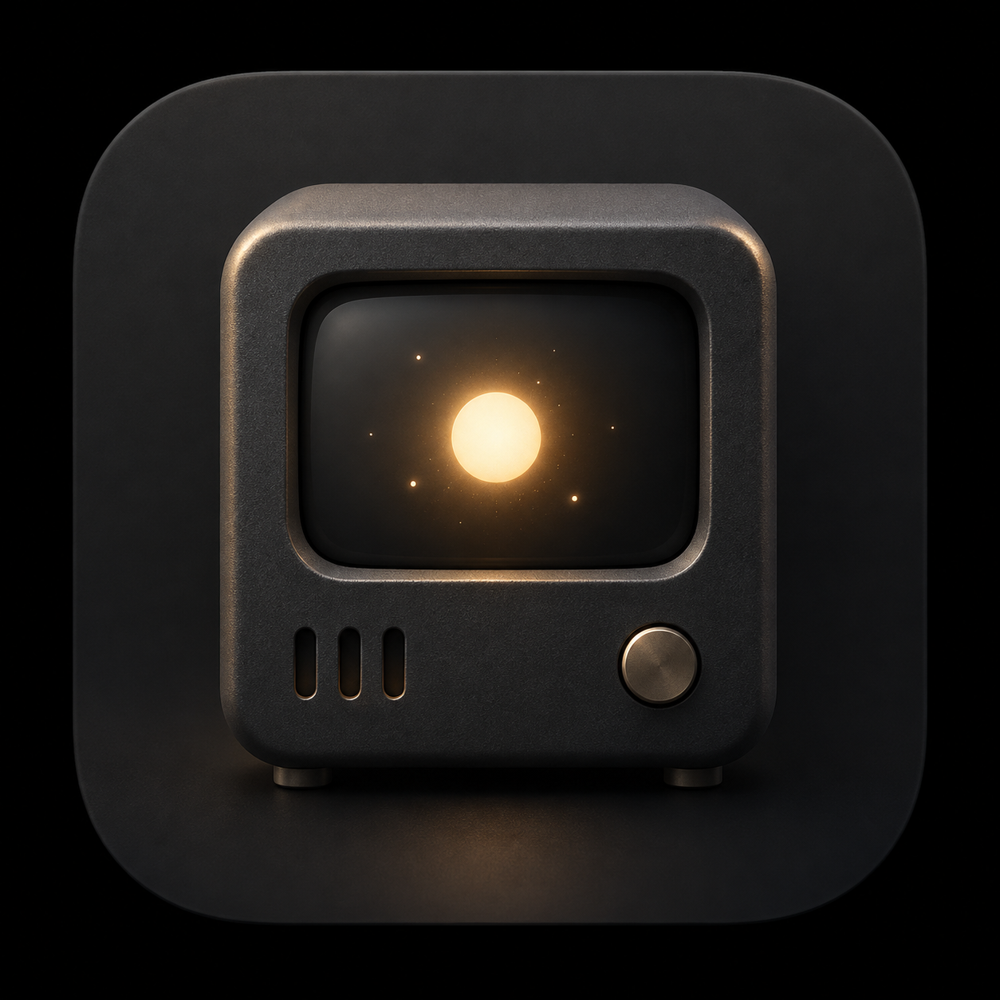

# Mote



Mote is a small emulator for [Uxn](https://wiki.xxiivv.com/site/uxn.html) and
[Varvara](https://wiki.xxiivv.com/site/varvara.html), written in C. I built it
to learn how a computer turns bytes in a file into words, pictures, and sound.
The processor, screen, audio, and file handling live in separate C files so
you can follow one part at a time.

If you're new to the project, start with [How Mote works](docs/HOW-IT-WORKS.md)
or try the [first hands-on lesson](lessons/00-workshop.md).

## What it can do

Mote runs Uxn programs, called ROMs. It builds two programs.

- `uxncli` runs text programs and tools in the terminal.
- `uxnemu` runs programs with a window, sound, keyboard, mouse, and game
  controller input.

You can drop a `.rom` file onto the window to open it. If the ROM includes a
name, Mote shows it in the title bar.

## Build and run on macOS

You’ll need the Xcode Command Line Tools for the C compiler and Make. With
Homebrew installed, run the following commands to build both programs.

```bash
brew install sdl2-compat pkgconf
git clone https://github.com/mxpf/uxn-emulator.git
cd uxn-emulator
make
```

For the terminal version alone, run `make bin/uxncli`. It needs a C compiler
and Make. The windowed version also needs SDL2 and `pkg-config`.

To start a ROM, pass its filename to either program.

```bash
bin/uxnemu program.rom
bin/uxncli program.rom
```

To try the included greeting, run `make example`. On the first run, it uses
`curl` and `xxd` to fetch and unpack the Drifblim assembler. Mote then runs
Drifblim to assemble the example and runs the resulting ROM. It prints
`Hello from our Uxn!`.

## Make a Mac app

On a Mac with the build tools above, run `make dmg-check` to build and test
the disk image. Open `dist/Mote-macOS-<arch>.dmg`, drag **Mote** into
**Applications**, and open it from there. The app includes the libraries it
needs for graphics and sound. `make package` creates a ZIP instead.

The package is signed locally without Apple notarization. If macOS blocks
a copy you received, see [Apple's guidance on opening apps safely](https://support.apple.com/en-us/102445).

## File and command access

By default, a ROM can use files inside the folder where Mote started. Starting
commands on your computer is off by default. For a ROM you trust, you can
allow either action for one run.

```bash
bin/uxnemu --allow-filesystem program.rom
bin/uxnemu --allow-exec program.rom
```

`--allow-filesystem` lets the ROM use files outside that folder. On hosts that
support it, `--allow-exec` lets the ROM run commands with your user account's
permissions. Mote treats the permissions separately and never saves them.

## Check the work

Run `make check` for the offline tests. It builds both programs, checks the
processor, devices, keyboard and mouse input, and the Constellation prototype,
then runs a small ROM and saves a screenshot without opening a window. The
test uses `xxd` to unpack the ROM.

Run `make verify-online` to download and run the upstream tests and sample
programs from Hundred Rabbits. It also needs `curl`, `xxd`, and `rg`
(`brew install ripgrep`). See the [compatibility notes](docs/COMPATIBILITY.md)
for the last recorded results and what each test covers.

## Read further

- [Design promise](DESIGN.md) explains what belongs in the project and where
  it stops.
- [User guide](docs/USER-GUIDE.md) lists everyday commands and controls.
- [Architecture](docs/ARCHITECTURE.md) follows a byte through the emulator.
- [Constellation v0](docs/CONSTELLATION-V0.md) shows how two ROMs can send
  messages to each other. [Playinghaus](https://playing.haus/) hosts browser
  cartridges built from the Constellation branch of this repository.

## Acknowledgements

Uxn, Varvara, Uxntal, Drifblim, and the programs used for compatibility checks
come from [Hundred Rabbits](https://100r.ca/site/uxn.html) and the wider Uxn
community. Mote is an independent implementation.

## License

Mote's source and documentation are available under the
[MIT License](LICENSE).
